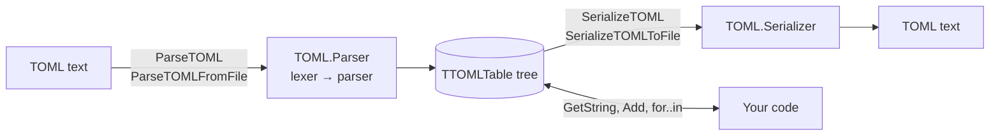
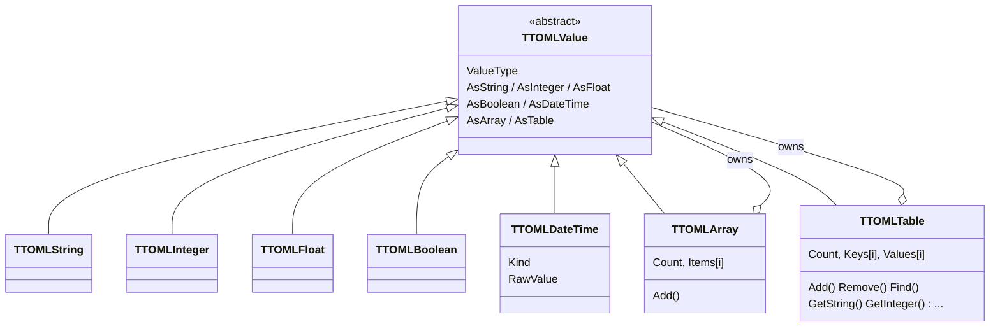

<p align="center">
  
</p>

# TOML-FP

[](https://opensource.org/licenses/MIT)
[](https://www.freepascal.org/)
[](https://www.lazarus-ide.org/)
[](https://toml.io/en/v1.1.0)
[](https://github.com/ikelaiah/toml-fp/actions/workflows/ci.yml)
[](CHANGELOG.md)

A [TOML](https://toml.io/) parser and serializer for Free Pascal, with full [TOML v1.1.0](https://toml.io/en/v1.1.0) support.

- **Correct:** passes every case of the official [`toml-test`](https://github.com/toml-lang/toml-test) v2.2.0 suite — 214/214 valid, 467/467 invalid, and 214/214 encoder cases.
- **Faithful output:** keys keep their order, floats round-trip exactly, and parsed documents serialize back the way they were written.
- **Simple to use:** one unit, typed lookups by path with defaults, ordered `for..in` over tables.
- **No dependencies:** only the FPC RTL.

## Contents

- [Quick start](#quick-start)
- [How it works](#how-it-works)
- [Reading values](#reading-values)
- [Building and writing documents](#building-and-writing-documents)
- [Output format](#output-format)
- [Memory management](#memory-management)
- [Error handling](#error-handling)
- [API reference](#api-reference)
- [TOML 1.1 notes](#toml-11-notes)
- [Installation](#installation)
- [Testing](#testing)
- [Examples](#examples)
- [Contributing](#contributing)

## Quick start

`config.toml`:

```toml
title = "My App"

[server]
host = "localhost"
port = 8080
```

```pascal
program QuickStart;

{$mode objfpc}{$H+}{$J-}

uses
  TOML;

var
  Config: TTOMLTable;
begin
  Config := ParseTOMLFromFile('config.toml');
  try
    WriteLn(Config.GetString(['title']));                   // My App
    WriteLn(Config.GetInteger(['server', 'port'], 80));     // 8080
    WriteLn(Config.GetBoolean(['server', 'tls'], False));   // FALSE (missing, so default)

    Config.Add('debug', TOMLBoolean(True));
    WriteLn(SerializeTOML(Config));
  finally
    Config.Free;  // frees the whole tree
  end;
end.
```

Output of `SerializeTOML`:

```toml
title = "My App"
debug = true

[server]
host = "localhost"
port = 8080
```

## How it works



A document is a tree of `TTOMLValue` objects. Tables and arrays own their children.



| Unit | Role |
| --- | --- |
| `TOML` | The only unit most programs need. Re-exports the types and helpers. |
| `TOML.Types` | Value classes. Use it for `TTOMLValueType` constants such as `tvtTable`. |
| `TOML.Parser` | Text → tree. |
| `TOML.Serializer` | Tree → text. |

## Reading values

**By path, with a default.** Each path element is one key, so keys containing dots need no quoting:

```pascal
Host  := Config.GetString(['server', 'host'], 'localhost');
Port  := Config.GetInteger(['server', 'port'], 8080);
Ratio := Config.GetFloat(['limits', 'ratio'], 0.5);    // integers widen to float
Debug := Config.GetBoolean(['debug']);                  // default False
Site  := Config.GetString(['site', 'example.com']);     // key "example.com"
```

The default is returned only when the path does not exist. A value of the wrong type raises `ETOMLException`, so a typo like `port = "8080"` is caught instead of silently ignored.

**Tables, arrays and raw values:**

```pascal
Server := Config.GetTable(['server']);     // nil if missing or not a table
Ports  := Config.GetArray(['ports']);      // nil if missing or not an array
Value  := Config.FindPath(['a', 'b']);     // TTOMLValue or nil
Value  := Config.Find('title');            // one key, or nil
if Config.Contains('title') then ...
```

**In document order:**

```pascal
var
  Pair: TTOMLKeyValuePair;
  Item: TTOMLValue;
begin
  for Pair in Config do
    WriteLn(Pair.Key, ' : ', Ord(Pair.Value.ValueType));

  for Item in Config.GetArray(['ports']) do
    WriteLn(Item.AsInteger);
end;
```

`Config.Keys[i]` and `Config.Values[i]` give indexed access in the same order. `Config.Items` is the underlying dictionary; its own enumeration order is unspecified.

## Building and writing documents

```pascal
var
  Config, Server, Route: TTOMLTable;
  Ports, Routes: TTOMLArray;
begin
  Config := TOMLTable;
  try
    Config.Add('title', TOMLString('My App'));
    Config.Add('version', TOMLFloat(1.0));

    Server := TOMLTable;
    Server.Add('host', TOMLString('127.0.0.1'));
    Ports := TOMLArray;
    Ports.Add(TOMLInteger(80));
    Ports.Add(TOMLInteger(443));
    Server.Add('ports', Ports);
    Config.Add('server', Server);

    Routes := TOMLArray;
    Route := TOMLTable;
    Route.Add('path', TOMLString('/'));
    Routes.Add(Route);
    Config.Add('routes', Routes);

    if not SerializeTOMLToFile(Config, 'config.toml') then
      WriteLn('Could not write config.toml');
  finally
    Config.Free;
  end;
end;
```

Writes:

```toml
title = "My App"
version = 1.0

[server]
host = "127.0.0.1"
ports = [80, 443]

[[routes]]
path = "/"
```

To change a value, `Remove` the key (this frees the old value) and `Add` it again. `Add` raises on a duplicate key.

## Output format

| Input | Output |
| --- | --- |
| Key order | Insertion order; plain keys before `[sections]` within each table |
| Table with only sub-tables | No header of its own: `[server.http]`, not `[server]` + `[server.http]` |
| Array of tables | `[[name]]` sections |
| Table inside an array or inline table | Inline: `[1, { x = 1 }]` |
| Long arrays | One line up to 80 columns, then one item per line with a trailing comma |
| Floats | Shortest exact form: `1.0`, `0.1`, `3.141592653589793`, `1e300`, `inf`, `nan`. Never locale-dependent |
| Strings | Basic quoted strings; control characters escaped, UTF-8 kept as is |
| Keys | Bare when possible, quoted otherwise: `"fruit.apple"` |
| Date/times | Parsed values keep their text (normalized to `T` and with seconds). A `TDateTime` from `TOMLDateTime(Now)` is written as a local date-time: `2026-11-17T09:30:00` |

Literal dotted keys versus nested tables:

```pascal
Config.Add('server.database', T);   // one key with a dot  → ["server.database"]
Server.Add('database', T);          // nested tables        → [server.database]
Config.Add('server', Server);
```

## Memory management

- `ParseTOML`, `ParseTOMLFromFile` and the `TOML…` helpers return new objects; you own them.
- `Add` transfers ownership to the parent table or array.
- **Free only the root.** It frees everything beneath it. Never free a value you have added.
- `Remove` frees the removed value.

```pascal
Config := ParseTOML(Text);
try
  // ...
finally
  Config.Free;
end;
```

## Error handling

| Exception | Raised when |
| --- | --- |
| `ETOMLParserException` | Invalid TOML, invalid UTF-8, or a duplicate key. Messages include the line, e.g. `Duplicate key "a" at line 3` |
| `ETOMLException` | A typed accessor (`AsInteger`, `GetString`, …) meets another type. Base class of the other two |
| `ETOMLSerializerException` | A value cannot be serialized |
| `EFOpenError` | `ParseTOMLFromFile` cannot open the file |

`SerializeTOMLToFile` returns `False` instead of raising.

```pascal
try
  Config := ParseTOML('port = 80' + LineEnding + 'port = 81');
except
  on E: ETOMLParserException do
    WriteLn('Bad config: ', E.Message);
end;
```

## API reference

**Parsing and serializing** (unit `TOML`)

| Function | Returns |
| --- | --- |
| `ParseTOML(const ATOML: string)` | `TTOMLTable` |
| `ParseTOMLFromFile(const AFileName: string)` | `TTOMLTable` |
| `SerializeTOML(const AValue: TTOMLValue)` | `string` |
| `SerializeTOMLToFile(const AValue: TTOMLValue; const AFileName: string)` | `Boolean` |

**Creating values:** `TOMLString`, `TOMLInteger` (`Int64`), `TOMLFloat` (`Double`), `TOMLBoolean`, `TOMLDateTime` (`TDateTime`), `TOMLArray`, `TOMLTable`.

**`TTOMLTable`**

| Member | Description |
| --- | --- |
| `Add(Key, Value)` | Adds a pair and takes ownership. Raises on a duplicate key |
| `Remove(Key): Boolean` | Removes a key and frees its value |
| `Contains(Key)`, `Find(Key)`, `TryGetValue(Key, out Value)` | Single-key lookups |
| `FindPath(Path)` | Value at a key path, or `nil` |
| `GetString`, `GetInteger`, `GetFloat`, `GetBoolean` `(Path; Default)` | Typed lookup with a default |
| `GetTable(Path)`, `GetArray(Path)` | Typed lookup, or `nil` |
| `Count`, `Keys[i]`, `Values[i]`, `for Pair in Table` | Ordered access |

**`TTOMLArray`:** `Add(Value)`, `Count`, `Items[i]`, `GetItem(i)`, `for Item in Arr`.

**`TTOMLValue`:** `ValueType`, `AsString`, `AsInteger`, `AsFloat`, `AsBoolean`, `AsDateTime`, `AsArray`, `AsTable`.

**`TTOMLDateTime`:** `Kind` (`tdtOffsetDateTime`, `tdtLocalDateTime`, `tdtLocalDate`, `tdtLocalTime`), `RawValue`, `CanonicalText`.

## TOML 1.1 notes

TOML-FP reads the three additions of TOML 1.1:

```toml
prompt = "\e[1mready\e[0m"      # \e and \xHH escapes
latin  = "caf\xe9"
start  = 07:32                   # seconds are optional
server = {                       # inline tables may span lines
  host = "localhost",            # and hold comments
  ports = [8080, 8081],          # and end with a comma
}
```

- There is no TOML 1.0-only mode.
- Output avoids 1.1-only syntax (times always carry seconds, inline tables stay on one line), so TOML 1.0 parsers can read it.
- Input must be valid UTF-8; a leading byte order mark is skipped.

## Installation

Requirements: Free Pascal 3.2.2+, and Lazarus 4.8+ for the package and test projects.

```bash
git clone https://github.com/ikelaiah/toml-fp.git
```

Then either:

- add `src/` to your project's unit search path (`-Fu` or *Project Options → Paths*), or
- open `packages/lazarus/toml_fp.lpk` in Lazarus, compile it, and add it to your project's required packages.

## Testing

108 project tests (FPCUnit) plus the official `toml-test` v2.2.0 suite for TOML 1.1:

| Suite | Result |
| --- | --- |
| Project tests, Debug build with `heaptrc` | 108/108, 0 unfreed blocks |
| `toml-test` valid (decoder) | 214/214 |
| `toml-test` invalid (decoder) | 467/467 rejected |
| `toml-test` encoder | 214/214 |

Run the project tests from the repository root (use `tests\TestRunner.exe` on Windows):

```bash
lazbuild --build-all --build-mode=Debug tests/TestRunner.lpi
```

```bash
tests/TestRunner --all --format=plain
```

Expected summary:

```text
Number of run tests: 108
Number of errors:    0
Number of failures:  0
```

For the conformance suite see [tests/conformance/README.md](tests/conformance/README.md). Coverage details: [docs/Test-Coverage-Overview.md](docs/Test-Coverage-Overview.md).

## Examples

| Project | Shows |
| --- | --- |
| [BasicParseTOML](examples/BasicParseTOML) | Path lookups with defaults, ordered iteration |
| [BasicSerializeTOML](examples/BasicSerializeTOML) | Building a table and saving it |
| [ComplexSerializeTOML](examples/ComplexSerializeTOML) | Nested tables, arrays, floats and date-times |
| [ArrayOfTablesTOML](examples/ArrayOfTablesTOML) | `[[arrays.of.tables]]` and inline tables in arrays |
| [NestedableDemo](examples/NestedableDemo) | Multi-level tables |
| [DottedKeys](examples/DottedKeys) | Literal dotted keys vs nested tables |
| [BugFixTest_5](examples/BugFixTest_5) | Serializer class vs helper function |

Open the `.lpi` in Lazarus, or build with `lazbuild examples/BasicParseTOML/BasicParseTOML.lpi`. The test suite, [tests/TestCaseTOML.pas](tests/TestCaseTOML.pas), has many more small, focused examples.

## Contributing

See [CONTRIBUTING.md](CONTRIBUTING.md). In short: branch from `main`, add a test for every fix or feature, and keep the project tests and conformance suite green.

## License

MIT — see [LICENSE.md](LICENSE.md).

## Acknowledgments

- The TOML specification authors and the `toml-test` maintainers
- The Free Pascal and Lazarus communities
- [SilenceCFF](https://github.com/SilenceCCF)
- Everyone who has contributed
